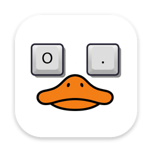

<div align="center">



# Duck Keyboard

**Hold a key. Talk. It's typed.**

A private voice assistant for the Mac: dictation in any app, a local AI that answers out loud and runs your Mac,<br>
meeting notes with speaker labels, and one-key writing tools. Every model runs on your Mac.

[](#requirements)
[](#requirements)
[](#build-from-source)
[](#privacy)

[**Download**](https://github.com/kanakapalli/AK-Assistant/releases/latest) ·
[**Website**](https://kanakapalli.github.io/AK-Assistant/) ·
[**Handbook**](https://kanakapalli.github.io/AK-Assistant/handbook.html) ·
[**Demo video**](AK-Assistant-Demo.mp4)

</div>

---

## Four keys, four jobs

| Key | What it does |
| --- | --- |
| Hold **Right ⌥** | **Dictate.** Talk, let go, and your words are typed at the cursor in any app. |
| Hold **Right ⌘** | **Ask the AI.** A local model answers in the popup and reads it aloud, or runs a Mac command. |
| Double-tap **Right ⌥** | **Record a meeting.** Transcript, speaker labels, summary, decisions and to-dos. |
| **⌘G** · **⌘E** · **⌘P** · **⌘R** | **Writing tools.** Fix grammar, write as email, make it professional, make it rude, or your own. |

Every key can be changed in **Settings**.

## Features

### 🎙 Dictation
- Words appear in a popup at the top of the screen as you speak; the final text is pasted where your cursor is.
- Parakeet models on the Neural Engine add punctuation and capitals. Whisper covers Hindi and 90+ other languages.
- Filler words ("um", "uh") are removed, your clipboard is put back after pasting, and your speakers are muted while you talk.
- Press **Esc** while holding the key to cancel.

### ✨ AI assistant and Mac commands
- Ask anything; a chat model running on MLX answers in a few seconds and a natural voice (Qwen3-TTS) reads it out.
- Follow-up questions within 5 minutes keep the conversation.
- The same key runs your Mac: *"open Xcode"*, *"set a timer for 25 minutes"*, *"remind me at 5 pm to call mom"*, *"volume 30"*, *"take a screenshot"*, *"what's my battery?"*.
- Phrased differently or in another language (*"xcode kholo"*)? The AI works out which command you mean.
- Risky actions (quit, lock, shut down…) can ask before running.

### 👥 Meetings
- Records your mic **and** the Mac's audio, so Zoom, Meet and Teams calls are captured even with headphones on.
- Noise and echo reduction, then a clean-up pass when the meeting ends.
- Speaker labels ("You", "Speaker 1"…). Name a speaker once and the transcript, summary and to-dos update.
- Summary, key points, decisions and a to-do list written by the local AI. Play the audio from any line or export as Markdown.

### ✍️ Writing tools
- Click into a text field and press a shortcut. Duck Keyboard selects the text, copies it, rewrites it with the local AI and pastes it back.

  | Action | Shortcut | Default prompt |
  | --- | --- | --- |
  | Fix grammar and typos | ⌘G | Fixes mistakes only, keeps your wording and formatting |
  | Write as email | ⌘E | Greeting, short paragraphs, sign-off; keeps every fact |
  | Write as professional | ⌘P | Polite, confident, concise |
  | Make it rude | ⌘R | Blunt and sarcastic, no slurs or threats |
  | Your own | any | Add as many as you like, e.g. "Translate to Hindi" |

- Every prompt and shortcut is editable in **Settings › Grammar**.
- While an action is on, its shortcut belongs to Duck Keyboard (⌘P won't print). Change it or switch the action off if you need it.

### 🕘 History, search and Learn
- Dictations, AI questions and rewrites are saved on your Mac, grouped by day, with before/after for rewrites. Search, filter, copy or export as CSV or text.
- Optional **Smart search & memory** (EmbeddingGemma) finds things by meaning and matches commands in any language.
- The **Learn** screen explains every feature and lists everything you can say, with Try buttons.

## Privacy

Speech-to-text, the AI, the voice, meeting notes, rewrites and search all run on your Mac. There's no account and no server.

| | |
| --- | --- |
| Your voice, recordings, questions, answers, transcripts and rewritten text | Stay on your Mac |
| Downloading models from Hugging Face | Uses the internet |
| Websites and searches you ask to open | Uses the internet |

## Install

1. Download the latest **Duck-Keyboard-x.y.z.dmg** from [Releases](https://github.com/kanakapalli/AK-Assistant/releases/latest).
2. Drag **Duck Keyboard** into Applications and open it.
3. The first time, macOS blocks it because it isn't notarized: open **System Settings › Privacy & Security** and click **Open Anyway**.
4. Follow onboarding: allow the Microphone and Accessibility, pick your keys and download a speech model.

### Requirements

| | |
| --- | --- |
| Mac | Apple silicon (M1 or newer) |
| macOS | 15 Sequoia or later |
| Memory | 16 GB recommended with the AI on; 8 GB works with Qwen3 1.7B and Parakeet Redux |
| Disk | About 1–5 GB, depending on the models you choose |

## Models

All open source, downloaded once from Hugging Face, and managed in **Settings** next to the feature that uses them (speech in *Dictation*, AI and voice in *AI Assistant*).

<table>
<tr><th>Speech to text</th><th>AI (MLX)</th><th>Voice and search</th></tr>
<tr valign="top"><td>

| Model | Size |
| --- | --- |
| **Parakeet Ultra** (default) | ~650 MB |
| Nemotron Streaming (EN) | ~600 MB |
| Parakeet v2 (EN) | ~600 MB |
| Parakeet Redux | ~220 MB |
| Whisper Large v3 Turbo | 632 MB |

</td><td>

| Model | Size |
| --- | --- |
| **Qwen3 4B** (default) | 2.3 GB |
| Gemma 4 E4B | 5.2 GB |
| Gemma 4 E2B | 3.6 GB |
| Llama 3.2 3B | 1.8 GB |
| Qwen3 1.7B | 1.0 GB |

</td><td>

| Model | Size |
| --- | --- |
| **Qwen3 TTS 0.6B** | ~1 GB |
| Qwen3 TTS 1.7B | ~2.2 GB |
| EmbeddingGemma 300M | ~330 MB |

</td></tr>
</table>

You can also add your own speech or chat model from Hugging Face, a download link or a folder (**Add custom model…**), and choose per model whether it runs on the GPU, the Neural Engine or MLX.

## Build from source

```bash
git clone https://github.com/kanakapalli/AK-Assistant.git
cd AK-Assistant
open AKAssistant.xcodeproj
```

1. Xcode 26 or later downloads the Swift packages on first open (several minutes). Allow **Trust & Enable** for the `MLXHuggingFaceMacros` macros, and install the **Metal Toolchain** from Xcode › Settings › Components if asked.
2. Pick your Team under the **AKAssistant** target › **Signing & Capabilities**.
3. Press **⌘R**.

To make a DMG to share:

```bash
./make-dmg.sh                    # → dist/Duck-Keyboard-<version>.dmg
NOTARY_PROFILE=ak ./make-dmg.sh  # also notarize (needs a Developer ID certificate)
```

> **Accessibility after rebuilds:** macOS ties the permission to the app's signature. If the hotkey stops working after a rebuild, remove Duck Keyboard from System Settings › Privacy & Security › Accessibility and add it again.

<details>
<summary><b>How it works</b></summary>

```
Hold key ─▶ Recorder ─▶ Speech-to-text ─▶ Clean-up ─▶ Text inserter ─▶ focused text field
            16 kHz mono   Parakeet / Whisper  fillers,     Accessibility or ⌘V,
            in memory     (streams while       spacing      clipboard restored
                          you talk)
```

- **Hotkeys** (`Hotkey/HotkeyManager.swift`): modifier-only keys use `NSEvent` monitors; combos and writing-tool shortcuts use [KeyboardShortcuts](https://github.com/sindresorhus/KeyboardShortcuts).
- **Recording** (`Audio/`): `AVAudioEngine` to 16 kHz mono in memory; nothing is written to disk for dictation.
- **Transcription** (`Transcription/`): one engine protocol with WhisperKit, FluidAudio (Parakeet, Nemotron) and MLX backends. Models load when you press the key and stay warm.
- **AI** (`Assistant/LLMService.swift`): MLX chat models with a short conversation; `SpeechService` speaks sentence by sentence as the answer streams.
- **Mac commands** (`Tools/`): `CommandParser` recognises common phrasings instantly; anything else can come back from the AI as `ACTION: …`. `CommandRunner` carries it out.
- **Writing tools** (`Assistant/TextActions.swift`, `GrammarFixer.swift`): ⌘A + ⌘C, rewrite with the action's prompt, paste back, restore the clipboard.
- **Meetings** (`Meetings/`): mic + ScreenCaptureKit system audio, VAD-based clean-up pass, offline speaker diarization, AI notes.
- **History** (`History/`): SwiftData, with retention settings and export.

</details>

<details>
<summary><b>Project layout</b></summary>

```
AKAssistant/
├── AKAssistantApp.swift   App entry: main window + menu bar
├── App/                   AppState (all pipelines), Preferences
├── Audio/                 Recorder, speaker muting
├── Hotkey/                Push-to-talk keys
├── Transcription/         Speech engines and service
├── Assistant/             Chat model, voice, writing tools
├── Tools/                 Mac commands, app finder, timers
├── Meetings/              Recorder, clean-up, speakers, notes
├── Memory/                EmbeddingGemma search and command matching
├── Models/                Model catalogs, downloads, custom models
├── Insertion/             Pasting into other apps
├── History/               SwiftData records, export
├── Support/               Permissions, sounds, text clean-up
└── UI/                    Popup, History, Meetings, Learn, Settings, onboarding
```

A good reading order: `AKAssistantApp.swift` → `App/AppState.swift` (follow `beginRecording` and `endRecording`) → `Hotkey/` → `Audio/` → `Transcription/` → `Insertion/` → `UI/`. The full walkthrough is in the [Handbook](https://kanakapalli.github.io/AK-Assistant/handbook.html).

</details>

<details>
<summary><b>Permissions</b></summary>

| Permission | Why |
| --- | --- |
| Microphone | Recording while a key is held, and meetings |
| Accessibility | Seeing the keys in other apps and pasting into them |
| Screen & System Audio Recording | Meetings only: the Mac's audio (the picture is ignored). Optional. |
| Automation | Dark mode, Empty Trash, restart/shut down (asked once) |
| Notifications | Timers and reminders |

The app isn't sandboxed, because the App Sandbox blocks simulated key presses into other apps. Distribute it outside the Mac App Store.

</details>

## Troubleshooting

| Problem | Fix |
| --- | --- |
| The key does nothing | Check **Settings › Permissions** and the Hotkey check there. After a rebuild, re-add the app under Accessibility. |
| Fn opens the emoji picker | System Settings › Keyboard › "Press 🌐 key to" › Do Nothing |
| Text isn't pasted | Password fields and Terminal's Secure Keyboard Entry block it; the text is on your clipboard, press ⌘V. |
| ⌘P / ⌘R don't work in other apps | A writing tool is using them. Change its shortcut or turn it off in **Settings › Grammar**. |
| "Download … first" | Download the model on the matching Settings page (Dictation or AI Assistant). |
| First AI answer is slow | The model loads once (a few seconds), then stays ready. On 8 GB Macs pick a smaller one. |

## Roadmap

- [ ] Remember named voices across meetings
- [ ] Custom vocabulary (names, jargon) for speech-to-text
- [ ] Per-app paste settings
- [ ] Developer ID signing, notarization and automatic updates

## Credits

- [WhisperKit and TTSKit](https://github.com/argmaxinc/argmax-oss-swift) by Argmax (MIT)
- [MLX Swift LM](https://github.com/ml-explore/mlx-swift-lm) by Apple (MIT)
- [FluidAudio](https://github.com/FluidInference/FluidAudio) by FluidInference (Apache 2.0)
- [Swift Hugging Face](https://github.com/huggingface/swift-huggingface) and [Swift Transformers](https://github.com/huggingface/swift-transformers) by Hugging Face (Apache 2.0)
- [KeyboardShortcuts](https://github.com/sindresorhus/KeyboardShortcuts) by Sindre Sorhus (MIT)
- Models: NVIDIA Parakeet and Nemotron (CC-BY-4.0), OpenAI Whisper (MIT), Qwen3 and Qwen3-TTS (Apache 2.0), Gemma 4 and EmbeddingGemma (Gemma license), Llama 3.2 (Llama 3.2 Community License)
